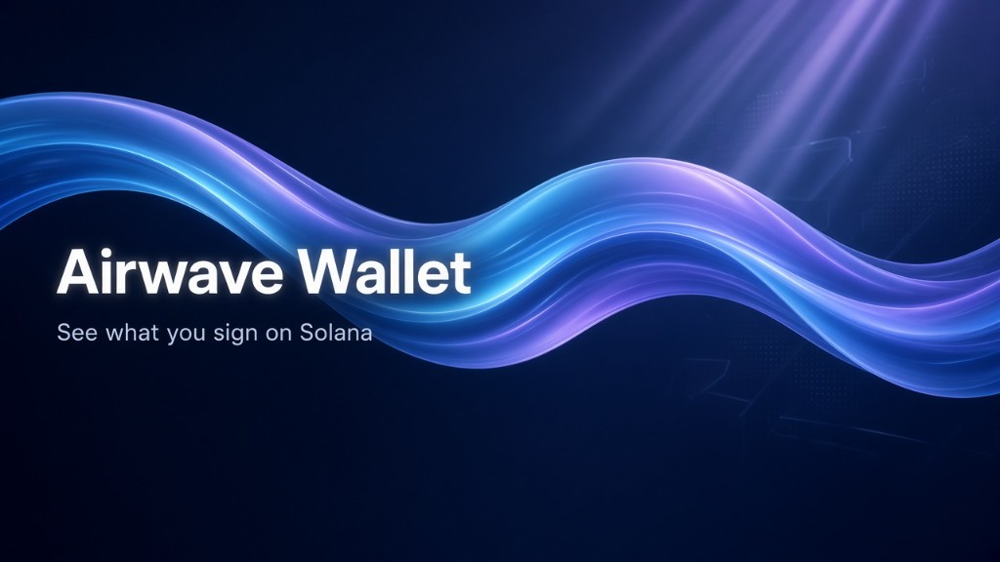
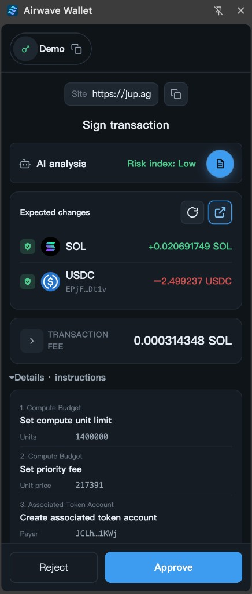
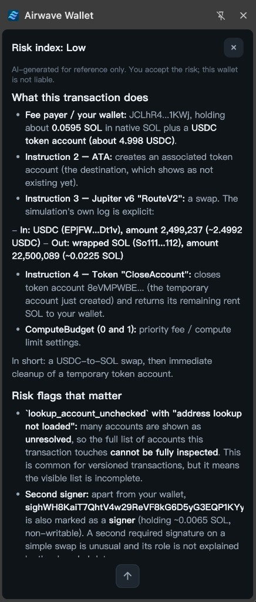

# Airwave Wallet

**See what you sign on Solana.**

Airwave is a non-custodial Solana Chrome extension wallet. Private keys stay on this machine: they are encrypted with your wallet password and written to extension storage. Sites never see the vault. Before you approve, the wallet shows the site, expected balance changes, the fee, and each instruction. Optional transaction AI is read-only: it can explain the transaction, and it never signs for you.

This is a developer preview. Build from this repo and load it into Chrome. It is not on the Chrome Web Store.

Official account: [@airwavewallet](https://x.com/airwavewallet) on X.



## What approval looks like

<table>
  <tr>
    <td width="50%" valign="top">
      
    </td>
    <td width="50%" valign="top">
      
    </td>
  </tr>
</table>

Approving is still your action. The risk report is there to read, not to approve for you.

| | |
|---|---|
| Version | [`version.md`](version.md) (currently 0.44.0) |
| Changelog | [`changelog.md`](changelog.md) |
| Disclaimer / terms | [`docs/legal/`](docs/legal/) |

---

## Start here

| If you want to… | Read |
|-----------------|------|
| Use the wallet | [docs/user-guide.md](docs/user-guide.md) (Helius RPC / API, optional OpenRouter transaction AI) |
| See what it can do | [docs/features.md](docs/features.md) |
| Build or change the code | [dev-docs/setup.md](dev-docs/setup.md) |

Rules and architecture constraints for coding agents live in [AGENTS.md](AGENTS.md), not on this page.

---

## This repository

```text
airwave-wallet/
├── wallet/          Chrome extension
├── test-web/        Minimal dApp for connect / sign tests
├── docs/            User guides, legal, showcase images
├── dev-docs/        Roadmap, design, domain, research, setup
├── AGENTS.md
├── version.md
└── changelog.md
```

Product docs: [docs/README.md](docs/README.md).  
Engineering process: [dev-docs/README.md](dev-docs/README.md).

---

## License

Code is licensed under the [Apache License 2.0](LICENSE) (Copyright 2026 Airic Yu).
